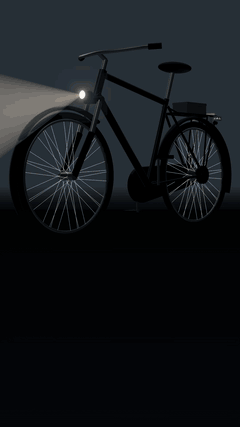
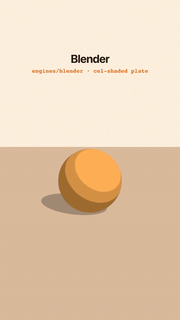
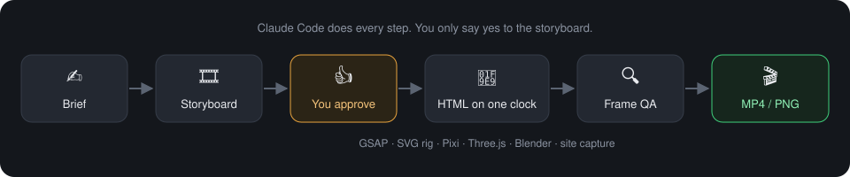
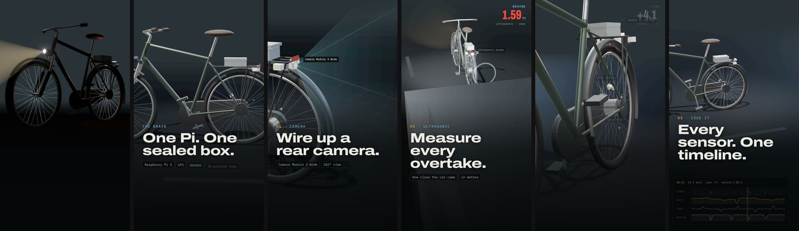
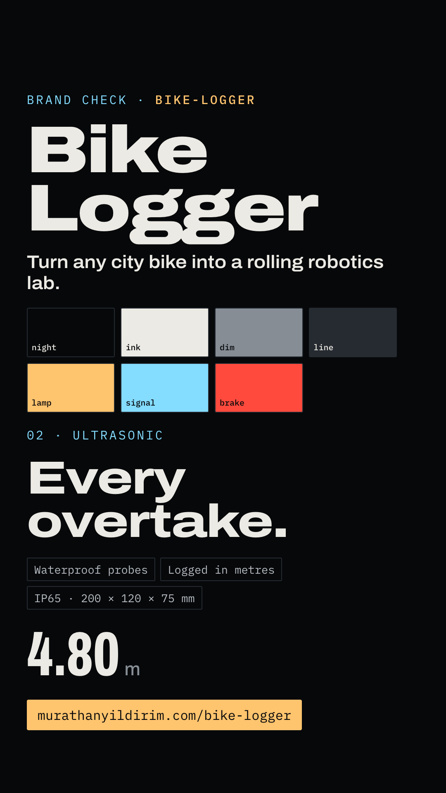
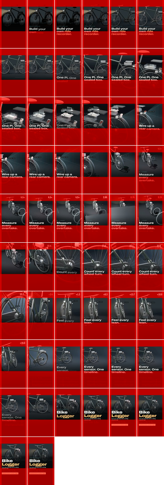
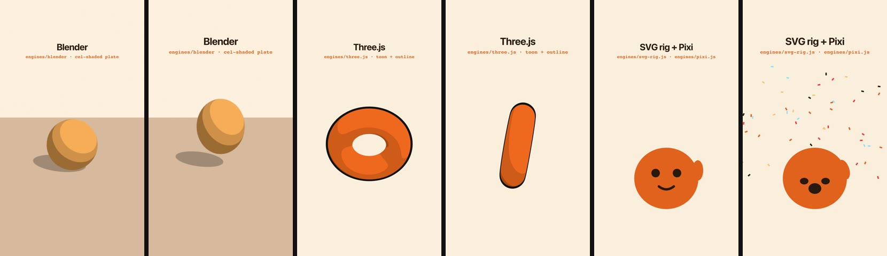

<h1 align="center">🎬 Reel Studio</h1>

<p align="center">
  <a href="https://github.com/murathany7/reel-studio/actions/workflows/ci.yml"></a>
  <a href="https://www.npmjs.com/package/reel-studio"></a>
  <a href="https://pypi.org/project/reel-studio/"></a>
  <a href="https://github.com/murathany7/homebrew-reel-studio"></a>
  <a href="LICENSE"></a>
  
</p>

<p align="center"><b>Agency-quality reels, ads and posts, made by Claude Code.</b><br>
Open source and free. Your Claude subscription does the rest.<br>
No editor, no timeline, no per-video fees. Every frame is code you own.</p>

<p align="center"><sub>Plain HTML pages on one clock → headless Chrome → MP4, for any brand. Every frame is reproducible.<br>
AI voiceover (ElevenLabs) is optional and billed by its provider.</sub></p>

<p align="center">
  
  &nbsp;&nbsp;
  
</p>
<p align="center"><sub>Left: <b>Bike Logger</b> kit reel (28 s, made by an agent from the product's live site) · Right: one 6 s reel using every engine<br>
Full-quality MP4s: <a href="https://github.com/murathany7/reel-studio/releases/latest">Releases</a></sub></p>

---

## How it works

<p align="center"></p>

You ask Claude Code: *"make a reel for &lt;brand&gt;"*. It writes a brief and a storyboard, waits for your yes, builds the
piece as an HTML page, renders every frame, checks them, and delivers a folder with the video and how it was made.

## Example: Bike Logger

A robotics kit reel, built by capturing the product's own 3D web page and laying brand copy on top.

<p align="center"></p>

| What | Where |
|---|---|
| 🏷️ The brand: facts + sources, colours, fonts, voice, rules | [`brands/bike-logger/`](brands/bike-logger) |
| 📝 Brief → storyboard → fact check → delivery notes | [`productions/bike-logger/REEL-001-kit/README.md`](productions/bike-logger/REEL-001-kit/README.md) |
| 🧩 The composition (one HTML page) | [`composition/index.html`](productions/bike-logger/REEL-001-kit/composition/index.html) |
| 🔍 The QA report | [`qa/report.md`](productions/bike-logger/REEL-001-kit/qa/report.md) |

<table><tr>
<td width="50%"><br><sub><b>Brand check</b>: one still that proves the brand's look renders right before any video is made.</sub></td>
<td width="50%"><br><sub><b>Frame QA</b>: a contact sheet with the platform's safe zones drawn over it, plus a motion check that flags jumps.</sub></td>
</tr></table>

## Engines, all on one clock

<p align="center"></p>

| Look | Engine |
|---|---|
| Text, UI, layouts | HTML/CSS + GSAP |
| Cartoon character | SVG rig · Lottie |
| Particles | Pixi.js |
| 3D, toon 3D | Three.js |
| Premium 3D, physics | Blender (pre-rendered plate) |
| Your live website | Page capture |

Mix them freely in one piece. Rules for keeping each frame a pure function of `t`: [`engines/README.md`](engines/README.md).

## Install

**In Claude Code** (recommended), two commands:

```
/plugin marketplace add murathany7/reel-studio
/plugin install reel-studio@reel-studio
```

Then, in the folder where your videos should live, ask:

> *Set up Reel Studio here*

It copies the renderer into the folder, installs it and checks Chrome and ffmpeg. You need
**Node 18+, Google Chrome and ffmpeg** (`brew install ffmpeg`). Blender is optional, for 3D plates.

**Or with npm**, in any folder (no plugin needed; the skills are copied into `.claude/skills/`):

```bash
npx reel-studio init
```

**Or with Python or Homebrew**, the same kit and the same `init` (the renderer still runs on Node):

```bash
pipx install reel-studio && reel-studio init      # or: uvx reel-studio init
brew install murathany7/reel-studio/reel-studio && reel-studio init   # brings Node and ffmpeg
```

**Or with Docker**, with Node, Chromium, ffmpeg and fonts inside, nothing to install (Linux renders use software WebGL):

```bash
docker run --rm -it -v "$PWD":/work ghcr.io/murathany7/reel-studio reel-studio init
docker run --rm -v "$PWD":/work ghcr.io/murathany7/reel-studio node core/render.mjs video <page>.html out.mp4
```

**Or clone it** and work inside the repo:

```bash
git clone https://github.com/murathany7/reel-studio && cd reel-studio
cd core && npm install && cd ..
```

## Use

> *Add my product as a new brand: https://my-product.com* → facts, colours, fonts, voice, rules
> *Make a 15 s reel for &lt;brand&gt; about &lt;feature&gt;* → brief and storyboard, then the video once you approve

That's the whole product: you talk to Claude Code, it writes the storyboard, waits for your OK in chat, then makes,
renders and checks the video.

**Optional: the desk.** If you'd rather review on a page than in chat, run `npx reel-studio desk` (or
`node desk/server.mjs`) and open <http://127.0.0.1:4100>. You can scrub frame by frame, pin notes to frames, send them
to Claude Code (your own login, no API key), render stills and previews, and approve the storyboard and the final cut.
Nothing else needs it, and nothing changes if you never open it. See [`desk/README.md`](desk/README.md).

## What's inside

```
core/          renderer (HTML → MP4/PNG) and the Studio clock
engines/       one adapter per engine
brands/        one folder per brand  (_template to start)
productions/   one folder per piece  (brief, composition, audio, QA, export)
scripts/       audio mix, transcription, QA, frame tools
desk/          optional local review app (and its optional reel-desk MCP server)
.claude/skills setup · make-video · new-brand · pick-engine · scene-3d · character-2d · capture-site · review-desk (optional)
```

## Contributing

Open source and early. New engine adapters, skill fixes and QA checks are all welcome: see
[CONTRIBUTING.md](CONTRIBUTING.md). `npm test` re-renders the demo twice and checks every frame matches.

**Made something?** [Show your reel](https://github.com/murathany7/reel-studio/issues/new?template=show-your-reel.yml):
good examples get featured here. Questions go to [Discussions](https://github.com/murathany7/reel-studio/discussions).

## License

[MIT](LICENSE). Brand folders (logos, copy, product facts) belong to their owners and are included only as examples.
