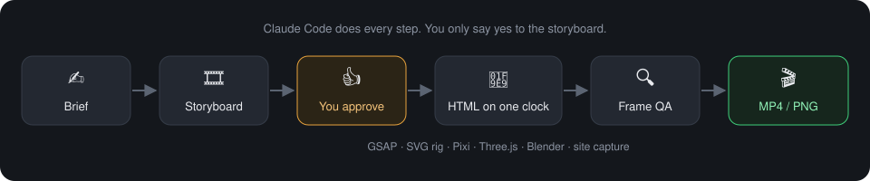
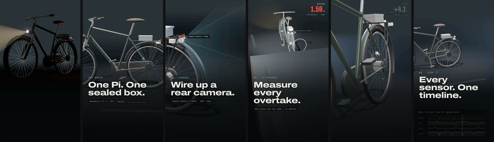
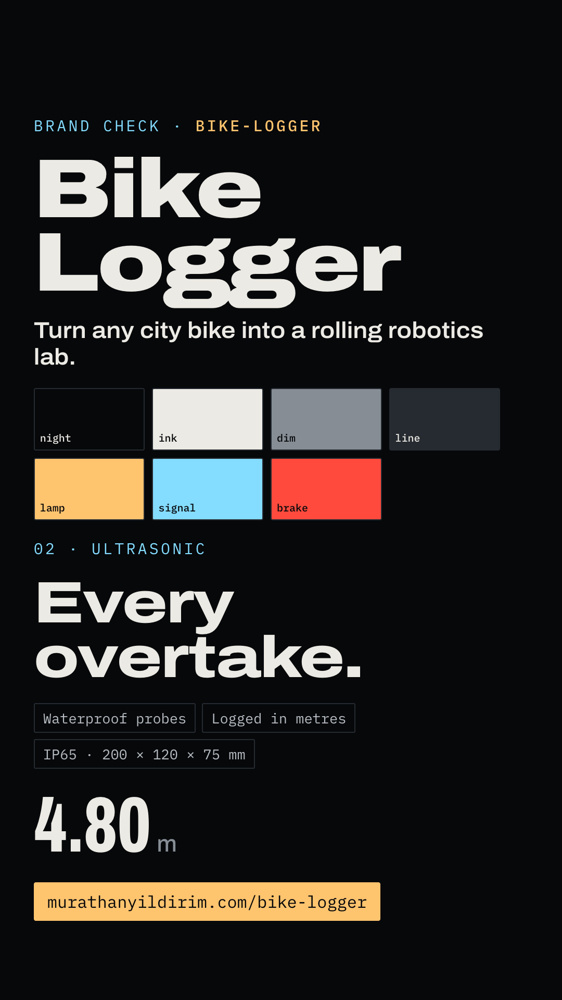
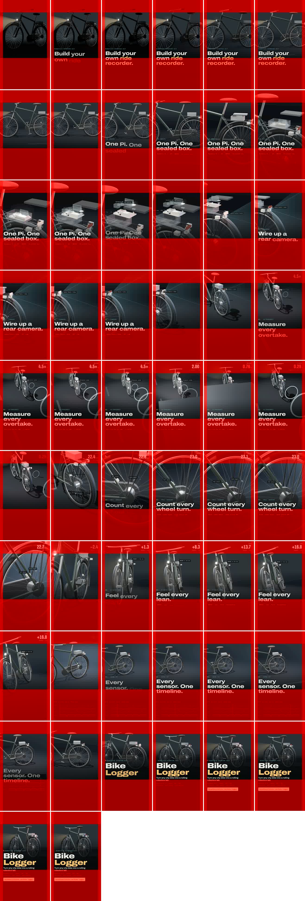

<!-- PyPI cannot resolve relative paths: every image and link here is absolute. -->
<h1 align="center">🎬 Reel Studio</h1>

<p align="center">
  <a href="https://pypi.org/project/reel-studio/"></a>
  <a href="https://www.npmjs.com/package/reel-studio"></a>
  <a href="https://github.com/murathany7/reel-studio/actions/workflows/ci.yml"></a>
  <a href="https://github.com/murathany7/reel-studio/blob/main/LICENSE"></a>
  <a href="https://github.com/murathany7/reel-studio"></a>
</p>

<p align="center"><b>Agency-quality reels, ads and posts, made by Claude Code.</b><br>
Open source and free. Your Claude subscription does the rest.<br>
No editor, no timeline, no per-video fees. Every frame is code you own.</p>

<p align="center"><sub><b>Bike Logger</b> robotics kit reel: 28 s, made by an agent from the product's own live 3D site.<br>
Watch it: <a href="https://github.com/murathany7/reel-studio/releases/latest">Releases</a></sub></p>

---

## Quick start

```bash
pipx install reel-studio      # or: uv tool install reel-studio
reel-studio init              # copy the kit and skills here and install the renderer
```

Or without installing anything: `uvx reel-studio init`.

The renderer runs on Node, so you also need **Node 18+, Google Chrome and ffmpeg**. Blender is optional, for 3D plates.
Then open the folder in Claude Code and ask:

> *Add my product as a new brand: https://my-product.com* → facts, colours, fonts, voice, rules
>
> *Make a 15 s reel for &lt;brand&gt; about &lt;feature&gt;* → brief and storyboard, then the video once you approve

## How it works

<p align="center"></p>

Claude Code writes a brief and a storyboard, waits for your yes, builds the piece as an HTML page, renders every
frame in headless Chrome, checks them, and delivers a folder with the video and how it was made.
Every frame is a pure function of time, so two renders are identical.

## Example: Bike Logger

A robotics kit reel, built by capturing the product's own 3D web page and laying brand copy on top.

<p align="center"></p>

<table><tr>
<td width="50%"><br><sub><b>Brand check</b>: one still that proves the brand's look renders right before any video is made.</sub></td>
<td width="50%"><br><sub><b>Frame QA</b>: a contact sheet with the platform's safe zones drawn over it, plus a motion check that flags jumps.</sub></td>
</tr></table>

Everything behind it is in the repo:
[the brand](https://github.com/murathany7/reel-studio/tree/main/brands/bike-logger) ·
[brief → storyboard → delivery](https://github.com/murathany7/reel-studio/blob/main/productions/bike-logger/REEL-001-kit/README.md) ·
[the composition](https://github.com/murathany7/reel-studio/blob/main/productions/bike-logger/REEL-001-kit/composition/index.html) ·
[the QA report](https://github.com/murathany7/reel-studio/blob/main/productions/bike-logger/REEL-001-kit/qa/report.md)

## Engines, all on one clock

| Look | Engine |
|---|---|
| Text, UI, layouts | HTML/CSS + GSAP |
| Cartoon character | SVG rig · Lottie |
| Particles | Pixi.js |
| 3D, toon 3D | Three.js |
| Premium 3D, physics | Blender (pre-rendered plate) |
| Your live website | Page capture |

Mix them freely in one piece.

## Other ways to install

This package ships the same kit as `npx reel-studio init`. Also available as a Claude Code plugin
(`/plugin marketplace add murathany7/reel-studio`), on Homebrew and as a Docker image:
see the [install guide](https://github.com/murathany7/reel-studio#install).

---

<p align="center"><a href="https://github.com/murathany7/reel-studio">GitHub</a> ·
<a href="https://github.com/murathany7/reel-studio/issues/new?template=show-your-reel.yml">Show your reel</a> ·
<a href="https://github.com/murathany7/reel-studio/discussions">Discussions</a> ·
MIT licence</p>
